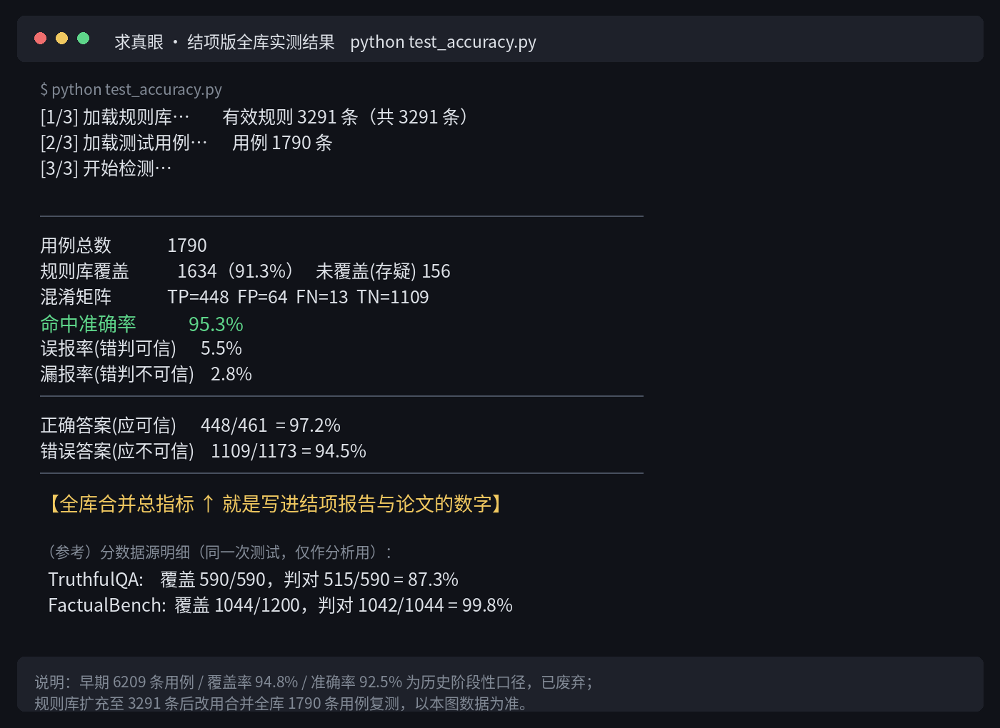

# 求真眼（QiuZhenYan）

> AI 生成内容可信度检测插件 —— 纯规则引擎，毫秒级响应，无需联网


## 一、项目简介

「求真眼」是一个基于规则匹配的事实核查引擎，用于判断 AI 生成的回答是否符合客观事实。它不调用任何外部模型或云端接口，完全本地运行、毫秒级响应，可作为插件或工具嵌入各类 AI 平台：在回答生成后自动检测，输出「可信 / 存疑 / 不可信」三级结论，并附带命中的规则编号、类别与判断依据。

本项目为北京物资学院大学生科学研究与创业行动计划结项成果，采用 MIT 协议开源。

## 二、核心特点

| 特点 | 说明 |
|---|---|
| 纯本地运行 | 无需联网、无需 API Key，普通 PC 即可部署 |
| 毫秒级响应 | 3291 条规则下单次检测平均 7.4 毫秒（200 次请求实测，P95 10.5 毫秒、最大 10.9 毫秒） |
| 可解释判定 | 返回 rule_id、category、message，结论可追溯到具体规则 |
| 三级输出 | 可信 / 存疑 / 不可信；未匹配到规则时回落「存疑」，不硬判 |
| 可持续扩展 | CSV/TXT 语料投放即自动扩库，10 秒轮询，规则文件修改后自动热重载，无需重启 |
| 网页控制台 | 原生 HTML + JavaScript，由服务首页直接提供，支持单条与批量检测 |

## 三、测试结果

### 3.1 全库真实语料（现行口径）

运行 `python test_accuracy.py`，直接读取 `rules.json` 与 `全库测试用例.csv`：

| 指标 | 结果 |
|---|---|
| 用例总数 | 1790 条（TruthfulQA 590 条 ＋ FactualBench 1200 条） |
| 规则覆盖 | 1634 条，覆盖率 91.3%；未覆盖 156 条回落「存疑」 |
| 命中准确率 | **95.3%** |
| 误报率 / 漏报率 | 5.5% / 2.8% |
| 混淆矩阵 | TP=448，FP=64，FN=13，TN=1109 |
| 正确答案判对 | 448/461（97.2%） |
| 错误答案判对 | 1109/1173（94.5%） |
| 分数据源 | FactualBench 99.8%，TruthfulQA 87.3% |



> **口径说明**：仓库早期版本曾以 TruthfulQA 中文版 6209 条用例给出覆盖率 94.8%、命中准确率 92.5%，属中期阶段性口径，现已废弃。规则库扩充至 3291 条后改用合并全库 1790 条用例复测，上表与截图为现行结果，结项报告与论文均以此为准。

### 3.2 构造用例（规则可执行性检验）

运行 `python test_full.py`，把每条规则展开为 4 条用例（1 正、2 错、1 同义改写）并加入否定句陷阱，共 13166 条，覆盖率 100.0%、命中准确率 99.9%。该脚本用于检验「规则能否被正确执行」，与 3.1 的真实语料口径不同，两者不可混用。

## 四、快速开始

```bash
pip install -r requirements.txt
python app.py
```

浏览器打开 `http://127.0.0.1:8080/` 即可使用网页控制台（单条检测 / 批量检测 / 规则统计）。

单条检测接口：

```bash
curl -X POST http://127.0.0.1:8080/check \
  -H "Content-Type: application/json" \
  -d '{"question": "中国的首都是哪里？", "answer": "北京"}'
```

返回包含 `level`、`rule_id`、`category`、`message` 的 JSON。

| 接口 | 方法 | 说明 |
|---|---|---|
| `/` | GET | 网页检测控制台 |
| `/check` | POST | 单条检测，入参 `question`、`answer` |
| `/check_batch` | POST | 批量检测，单次最多 500 条，超限返回 400 |
| `/stats` | GET | 规则库条数、分类统计与最后更新时间 |

## 五、规则扩展

把新的语料文件放进 `new_data/` 目录：

- **CSV**：需含 `question`、`answer` 两列（兼容 BOM 头）
- **TXT**：每行一条「问题,答案」，**仅支持英文逗号分隔**，中文逗号或无逗号的行会被跳过

然后二选一：

```bash
python auto_rule_generator.py   # 立即生成并合并规则，源文件自动移入 processed/
python watcher.py               # 常驻监控，每 10 秒轮询，新增文件自动触发生成
```

规则写入 `rules.json` 后，服务端每次请求比对文件修改时间自动热重载（加载失败时沿用内存旧规则继续服务），最多 10 秒生效，无需重启。`migrate_rules.py` 用于历史规则的字段补齐，升级前会自动备份。

> 说明：线上检测结果不会回写规则库，扩充只走离线脚本与目录监控，避免误判污染规则库。

## 六、文件说明

| 文件 | 说明 |
|---|---|
| `app.py` | Flask 服务主程序，提供 `/`、`/check`、`/check_batch`、`/stats`，含规则热重载 |
| `index.html` | 网页检测控制台（原生 HTML + JavaScript，不依赖前端框架） |
| `rules.json` | 规则库，3291 条（人工精编 817 条 ＋ 自动导入 2474 条），7 字段结构 |
| `auto_rule_generator.py` | 从 CSV/TXT 自动提取关键词、强限定词与同义词并合并入库 |
| `migrate_rules.py` | 历史规则字段补齐与备份 |
| `watcher.py` | 目录监控，10 秒轮询，触发规则生成并写 `.rules_updated` 标志 |
| `test_accuracy.py` | 全库真实语料评估（现行口径，输出混淆矩阵与分层准确率） |
| `test_full.py` | 构造用例评估（规则可执行性与错误归因） |
| `全库测试用例.csv` | 1790 条评估用例 |
| `test_result.png` | 全库实测结果截图 |
| `SKILL.md` | 面向平台集成方的接口入参与返回约定 |
| `requirements.txt` | 依赖清单 |

## 七、许可证与反馈

本项目采用 MIT 协议，详见 `LICENSE`。欢迎提交 Issue、Pull Request，也欢迎把新的问答语料放进 `new_data/` 一起扩充规则库。

---

北京物资学院「求真眼」项目组 · 2026 年结项版
